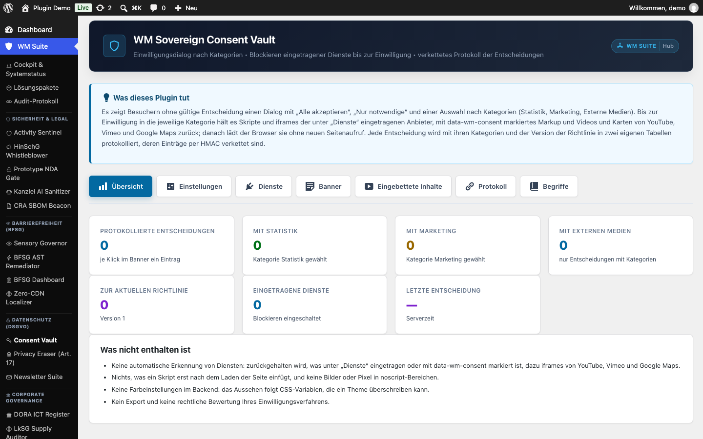
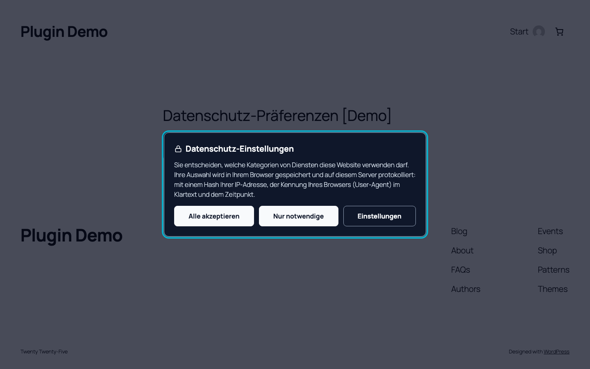
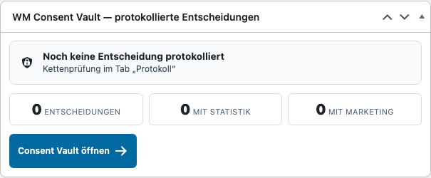

# WM Sovereign Consent Vault (Deutsche Dokumentation)

<p align="center">
  <a href="README.md"></a>
  <a href="README.de.md"></a>
  <a href="README.es.md"></a>
</p>

> **Fragt Besucher nach Kategorien, hält Skripte und eingebettete Inhalte der eingetragenen Dienste bis zur Einwilligung zurück und protokolliert jede Entscheidung mit ihren Kategorien in der eigenen Datenbank als HMAC-verketteten Eintrag**  
> **Plugin-Seite:** [https://arnoldwender.com/wordpress-plugins/wm-sovereign-consent-vault/](https://arnoldwender.com/wordpress-plugins/wm-sovereign-consent-vault/)  
> **Mit einem agentischen Workflow entwickelt:** entstanden mit KI-Coding-Agenten. Prüfen und testen Sie es wie jeden fremden Code, bevor Sie es produktiv einsetzen.  
> **Support & Haftung:** Kein Support (Zero Support) — reproduzierbare Bugs ausschließlich über [GitHub Issues](https://github.com/arnoldwender/wm-wp-sovereign-consent-vault/issues) · kein privater Support · OHNE GEWÄHR („AS IS“) / keine Haftung ([SUPPORT.md](SUPPORT.md))

> Gemessen an Version `1.2.2` des Codes: Shortcode `[wm_consent_settings]`, WP-CLI `wp consent audit_merkle`, REST-Endpunkte `/nonce`, `/record` und `/verify-merkle` unter `wm-consent/v1`, WordPress-6.5+-Block-Bindings (`wm-consent/status`), GenerateBlocks-2.x-Dynamic-Tag (`{{wm_consent_status}}`), die Tabellen `wp_wm_consent_records` und `wp_wm_consent_merkle_nodes` (lineare HMAC-SHA256-Kette), explizite Opt-in-Datenlöschung bei der Deinstallation sowie 28 kompilierte `.po`-/`.mo`-Sprachkataloge. Das Plugin nimmt keine rechtliche Bewertung einer Website vor.

---

## Live-Vorschau

!WM Sovereign Consent Vault Banner

| Konsole | Einwilligungsdialog | Dashboard-Widget |
|---|---|---|
|  |  |  |

---

## Was das Plugin leistet

1. **Einwilligungsdialog nach Kategorien:** In `wp_footer` erscheint für jeden Besucher, dessen Browser keine Entscheidung zur aktuellen Version der Richtlinie hält, ein modaler Dialog (`role="dialog"`, `aria-modal`, benannt durch seine Überschrift und beschrieben durch seinen Text) mit „Alle akzeptieren“ und „Nur notwendige“ in derselben Gestaltung und „Einstellungen“ für einen Schalter je Kategorie: **notwendig** (immer aktiv), **Statistik**, **Marketing** und **Externe Medien**, jede mit ihrer Beschreibung und den eingetragenen Diensten dieser Kategorie (Anbieter, Zweck, Cookies, Datenschutzerklärung des Anbieters). Das Skript setzt den Fokus in den Dialog, hält ihn beim Tabben darin und gibt ihn beim Schließen zurück; den Dialog des ersten Besuchs schließt nur eine Wahl, einen absichtlich geöffneten auch Escape oder die Schließen-Schaltfläche. Farben und Größen stammen aus Custom Properties in `assets/css/wm-consent-vault.css` (keine Inline-Styles, Textkontrast mindestens 4,5:1, Ziele mindestens 44 px). Verlinkt werden die Datenschutzerklärung (die Seite aus Einstellungen › Datenschutz, sofern keine andere URL eingetragen ist) und das Impressum; auf diesen beiden Seiten öffnet sich der Dialog nicht von selbst. Erneut öffnen: `[wm_consent_settings]`, ein Link auf `#wm-consent-settings`, ein Element mit `data-wm-consent-open` oder `window.wmConsent.open()`.
2. **Blockieren vor der Einwilligung:** Auf jeder Seite im Frontend schreibt `includes/Blocker/OutputBlocker.php` das HTML um — über einen Ausgabepuffer (spät auf `template_redirect` geöffnet, damit ein Caching-Plugin die blockierte Seite speichert) und über `wp_script_attributes`, `wp_inline_script_attributes` und `script_loader_tag` für die Skripte, die WordPress selbst ausgibt. Ein `<script>`, dessen Quelle oder Inline-Code ein Muster eines eingetragenen Dienstes enthält, und ein mit `data-wm-consent="marketing"` markiertes Skript werden zu `type="text/plain"` mit `data-wm-consent-category`, `data-wm-consent-service`, der Quelle in `data-wm-consent-src` und einem `module`-Typ in `data-wm-consent-type`. Ein `<iframe>` von YouTube, Vimeo oder Google Maps und eines eines eingetragenen Dienstes der Kategorie Externe Medien werden zum 2-Klick-Platzhalter; ein iframe einer anderen Kategorie behält seine Quelle in `data-wm-consent-src`. Der Server schreibt immer die blockierte Fassung, unabhängig von der Entscheidung des Besuchers, damit ein Ganzseiten-Cache keine entsperrte Seite an den nächsten Besucher ausliefert. Nach einer Entscheidung aktiviert das Skript das Freigegebene in Dokumentreihenfolge — ein externes Skript ohne `async` wird abgewartet, bevor das nächste läuft — ohne die Seite neu zu laden. Wird eine Kategorie zurückgenommen, löscht es die eingetragenen Cookies ihrer Dienste auf dieser Website und lädt neu. Unberührt bleiben: andere Skripttypen (JSON-LD, Importmaps), alles mit `data-wm-consent-ignore`, die eigenen Tags des Plugins, HTML-Kommentare, `<style>`, `<textarea>`.
3. **Dienste und Vorlagen:** Unter **Consent Vault › Dienste** trägt ein Dienst Name, Kennung, Anbieter, Kategorie, Zweck, Datenschutzerklärung des Anbieters, Cookie-Namen (`_ga_*` steht für eine Familie) und Host- oder Dateimuster (`googletagmanager.com`, `matomo.js`), die als ganze Host- oder Dateinamen treffen. Zehn Vorlagen stehen bereit für Google Analytics / Tag Manager, Meta Pixel, Matomo, Hotjar, Microsoft Clarity, LinkedIn Insight Tag, TikTok Pixel, YouTube, Vimeo und Google Maps; ihre Hosts und Cookies wurden am 2026-09-17 aus der Dokumentation oder dem Code des jeweiligen Anbieters gelesen (die Quellen stehen in `ServiceRegistry::presets()`). Eine Vorlage wird erst zum Dienst, wenn eine Administratorin sie hinzufügt.
4. **Einstellungen:** **Consent Vault › Einstellungen**: die Bannertexte als Überschreibungen der übersetzbaren Standardtexte, die URLs von Datenschutzerklärung und Impressum, die Beschreibung jeder Kategorie, die **Version der Richtlinie** (ihre Erhöhung fragt alle Besucher erneut und wird mit jeder Entscheidung protokolliert), die **Gültigkeit in Tagen**, ein Schalter für das Blockieren sowie eine explizite Opt-in-Option (`wm_consent_delete_data_on_uninstall`) zum Löschen von Protokollen, Tabellen und Einstellungen bei der Deinstallation. Die Standardtexte beschreiben, was das Plugin speichert, und behaupten keine Konformität.
5. **Protokoll der Entscheidungen:** `/nonce` erlaubt standardmäßig 120 Anfragen pro Minute je Client (gehashte IP, für Administratoren ausgenommen, filterbar über `wm_consent_rest_rate_limit`); `/record` verlangt den REST-Token (403), erlaubt 10 Anfragen pro Minute je Client (Schlüssel: HMAC der IP-Adresse, bei IPv6 je /64, 429) und deklariert seine Parameter: `uuid` als Zeichenkette aus 8–64 Zeichen `[A-Za-z0-9_-]`, die drei Schalter als Boolean, optional `categories` (die vier Kennungen) und `policy_version`; Schalter, die den Kategorien widersprechen, eine unbekannte Kategorie oder eine unzulässige Version antworten mit 400. Eine gespeicherte uuid antwortet vor jedem Schreibversuch mit 409, eine belegte Kette mit 503 und eine nicht geschriebene Entscheidung mit 500. Gespeichert werden die uuid, ein HMAC-SHA256 der IP-Adresse (Schlüssel `wp_salt( 'auth' )`), die drei Werte, die gewählten Kategorien, die Version der Richtlinie, die ersten 255 Zeichen des User-Agents, eine Signatur darüber und der Zeitpunkt. Jede Entscheidung hängt unter der Datenbanksperre `wm_consent_chain` einen Knoten an eine lineare Kette: Vorgänger, Signatur und eine HMAC-Verkettung beider, Eintrag und Knoten in einer Transaktion. Der Vorgänger stammt aus der notierten Spitze, und die Option `wm_consent_chain_tip` hält Verkettung, Knotenzahl und eine Signatur über beide. `wm-dsgvo-privacy-eraser` hängt seine Zertifikatssiegel als Anker-Knoten an dieselbe Kette.
6. **Zwei Signaturformate:** Einträge von vor dem 2026-09-17 tragen Format 1 (uuid, gehashte IP-Adresse, die drei Werte, Zeitpunkt); neue Einträge tragen Format 2, das zusätzlich Kategorien, Version der Richtlinie und User-Agent signiert. Jeder Eintrag wird mit dem Format geprüft, in dem er geschrieben wurde, und keiner wird nachsigniert; ein Format-1-Eintrag, der Kategorien oder eine Version trägt — Spalten, die seine Signatur nicht abdeckt —, gilt als verändert.
7. **Prüfung:** `MerkleTreeEngine::verify_chain_integrity()` geht jeden Knoten durch: Vorgänger, Verkettung, die neu berechnete Signatur der zugehörigen Entscheidung, die Einträge ohne Knoten sowie die gespeicherte Spitze mit Signatur und Anzahl. Ergebnis `INTACT` (mit der Anzahl je Signaturformat), `EMPTY_CHAIN` (noch nichts protokolliert) oder `TAMPERED` mit `PREV_HASH_MISMATCH`, `MERKLE_ROOT_CORRUPTED`, `CONSENT_RECORD_MISSING`, `CONSENT_RECORD_ALTERED`, `UNCHAINED_RECORD`, `TIP_UNSIGNED` / `TIP_SIGNATURE_INVALID` oder `CHAIN_TRUNCATED`. Verfügbar als `GET /wp-json/wm-consent/v1/verify-merkle` (`manage_options`), `wp consent audit_merkle`, Schaltfläche im Backend und Hub-Adapter. Die Prüfung erkennt Änderungen ohne den Schlüssel; sie zeigt nicht, dass eine Entscheidung von einem echten Besucher stammt.
8. **2-Klick-Platzhalter:** Jedes iframe von `youtube.com`, `youtube-nocookie.com`, `youtu.be`, `vimeo.com` / `player.vimeo.com`, `maps.google.com` oder `google.com/maps` — im Beitragsinhalt über `the_content` und, solange das Blockieren eingeschaltet ist, auf der ganzen Seite — wird durch eine Box ersetzt, die den Anbieter nennt und sagt, dass ein Klick die Verbindung herstellt und dabei die IP-Adresse überträgt; Quelle, Titel und Höhe des iframes stehen in Datenattributen. Auch eine Quelle ohne Protokoll (`//www.youtube.com/…`) wird erfasst. Ein Klick lädt genau diesen Inhalt und wird nicht protokolliert; die Einwilligung in Externe Medien lädt alle Platzhalter der Seite ohne Klick.
9. **Für Entwickler:** Markup `<script type="text/plain" data-wm-consent="marketing">…</script>` (mit oder ohne `src`) und `<iframe data-wm-consent="media" data-wm-consent-src="…">`. PHP: `wm_consent_has( 'statistics' )` liest das Cookie `wm_consent`, prüft es gegen Version und Gültigkeit und markiert die Antwort als nicht zwischenspeicherbar. JavaScript: `window.wmConsent.has( 'media' )`, `window.wmConsent.open()`, `window.wmConsent.categories()` und das Ereignis `wm-consent:decision` auf `document`. Block Bindings & Dynamic Tags: `wm-consent/status` (WP 6.5+) und `{{wm_consent_status}}` (GenerateBlocks 2.x). Filter: `wm_consent_services`, `wm_consent_script_handles`, `wm_consent_script_category`, `wm_consent_blocking_enabled`, `wm_consent_has`, `wm_consent_has_nocache`, `wm_consent_rest_rate_limit`, `wm_consent_status_label`. Aktionen: `wm_consent_ready`, `wm_consent_decision_recorded`.
10. **Backend:** Menü *Consent Vault* (Position 84), Seite `wm-consent-vault`, deutsche Oberfläche mit sieben Tabs: Übersicht (protokollierte Entscheidungen, je Kategorie, zur aktuellen Version, eingetragene Dienste, was nicht enthalten ist), Einstellungen, Dienste, das Banner wie Besucher es sehen, die Platzhalter-Anbieter, das Protokoll (Erklärung, Prüf-Schaltfläche, letzte zehn Knoten) und eine kurze Begriffsliste. Ein Dashboard-Widget zeigt die Zahlen, ohne die Kette zu prüfen. Admin-Stylesheets der WM-Suite-Familie.
11. **WM Suite Hub Spoke:** `includes/Adapters/Consent_Vault_Spoke_Adapter.php` meldet sich über `wm_register_suite_module`: Health `HEALTHY` für eine geprüfte Kette mit mindestens einem Knoten, `NEEDS_CONFIG`, solange nichts protokolliert ist, `ERROR`, wenn die Prüfung fehlschlägt; Telemetrie mit Anzahl der Entscheidungen (`null` ohne Tabelle), Entscheidungen je Kategorie, Version der Richtlinie und wie viele Entscheidungen zu ihr gehören, Kettenzustand und Fehler, Knotenzahl, Anzahl je Signaturformat, Schlüsselquelle, Spitze, Blockier-Schalter und Zahl der eingetragenen Dienste; Aktion `self_test` (schlägt bei leerer oder gebrochener Kette fehl).

### Nicht enthalten

Keine automatische Erkennung der Dienste einer Website: zurückgehalten wird, was eingetragen oder mit `data-wm-consent` markiert ist, dazu die eingebauten Embed-Anbieter. Nichts, was ein Skript erst nach dem Laden der Seite einfügt, und keine Bilder oder Pixel in `<noscript>`. Keine Signale an die Consent-Schnittstelle eines Anbieters (Google Consent Mode und Ähnliches). Keine Farbeinstellungen im Backend (das Aussehen folgt CSS-Variablen, die ein Theme überschreiben kann). Kein Export, Bericht oder Zertifikat. Kein Merkle-Baum (die Kette ist trotz des Klassennamens linear). Keine Bewertung, ob Dialog, Blockierung oder Protokoll eine rechtliche Anforderung erfüllen.

---

## Schnellstart

1. Plugin installieren und aktivieren (WordPress 6.4+, PHP 8.2+). Die Aktivierung legt die zwei Tabellen an; ein Update ergänzt die drei Spalten von Schema 3.
2. **Consent Vault › Dienste** öffnen und für jeden tatsächlich eingesetzten Dienst eine Vorlage hinzufügen oder einen eigenen Eintrag mit seinen Host- oder Dateimustern anlegen; die Angaben zum Anbieter ergänzen.
3. **Consent Vault › Einstellungen** prüfen: Texte, URLs von Datenschutzerklärung und Impressum, Beschreibungen, Gültigkeit und Version der Richtlinie.
4. Die Website in einem privaten Fenster öffnen: der Dialog erscheint, „Einstellungen“ zeigt die Kategorien mit ihren Diensten, und das Freigegebene lädt ohne neuen Seitenaufruf. Unter **Consent Vault › Übersicht** wird die Entscheidung gezählt.
5. `[wm_consent_settings]` auf die Seite der Datenschutzerklärung setzen oder einen Link auf `#wm-consent-settings` ins Menü, damit Besucher ihre Entscheidung ändern können.
6. Für eigenen Code: `<script type="text/plain" data-wm-consent="statistics">` im Markup, `wm_consent_has( 'statistics' )` in PHP.
7. Optional unter **Protokoll** auf **Kette jetzt prüfen** klicken oder `wp consent audit_merkle` ausführen.

Klassen, Routen, Tabellen, Optionen, Filter und bekannte Abweichungen: **[README.md](README.md)** (Referenz) und **[DEVELOPERS.md](DEVELOPERS.md)**.

```bash
php tests/test-suite.php        # Kategorien, Einstellungen, Dienste, Signaturformate, Blockieren, Dialog, Backend, Kette, Deinstallation
bash tests/run-mutations.sh     # jede Korrektur aus tests/mutations.php muss die Suite rot färben, wenn man sie zurücknimmt
# in einem Wegwerf-WordPress (leert die Consent-Tabellen):
wp eval-file wp-content/plugins/wm-sovereign-consent-vault/tests/test-consent-chain.php --allow-root
```

### Bekannte Einschränkungen

- Ob Formulierung, Kategorien und Blockierung einer Website eine rechtliche Anforderung erfüllen, bewertet das Plugin nicht; die Standardtexte sind neutral und juristisch nicht geprüft (Flotten-Audit D6).
- Blockiert wird nur, was eingetragen oder markiert ist: ein nicht eingetragener Dienst lädt wie bisher, und Markup, das ein Skript erst nach dem Laden einfügt, ist außer Reichweite.
- Die Entscheidung liegt im Browser des Besuchers. Jeder kann den öffentlichen Token abrufen und eine Entscheidung senden; die Begrenzung liegt bei 10 pro Minute je Client. Die Kette beweist, dass gespeicherte Zeilen nachträglich nicht geändert wurden, nicht, dass sie echt sind.
- `wm_consent_has()` macht eine Seite vom Besucher abhängig und markiert die Antwort deshalb als nicht zwischenspeicherbar (`DONOTCACHEPAGE` und No-Cache-Header). Markup, das ohne diesen Preis warten soll, gehört in `data-wm-consent`.
- Cookies werden beim Widerruf nur dort gelöscht, wo ein Skript dieser Website sie erreicht: diese Domain und ihre übergeordneten, Pfad `/`. Cookies auf der Domain eines Anbieters bleiben.
- Der Ausgabepuffer hält die Seite bis zu ihrem Ende zurück; ein Theme, das den Head früh ausliefert, verliert diesen Vorsprung.
- Die IP-Adresse wird als geschlüsselter Hash gespeichert (pseudonym, nicht anonym); der User-Agent im Klartext, ab Format 2 signiert.
- Die Prüfung stellt eine Abfrage je Knoten; Health und Telemetrie des Hubs führen sie bei jedem Aufruf aus, was mit dem Protokoll wächst.
- Die Deinstallation bewahrt standardmäßig beide Tabellen und die Optionen des Plugins auf, sofern unter **Consent Vault › Einstellungen** nicht ausdrücklich `wm_consent_delete_data_on_uninstall` aktiviert wurde.
- Platzhalter und seitenweites Umschreiben arbeiten auf dem HTML als Text; Markup, das kein gültiges HTML ist, kann unverändert durchgehen.
- Zeilen, die eine andere Installation geschrieben hat (eine kopierte Datenbank), tragen deren Schlüssel und gelten hier als `MERKLE_ROOT_CORRUPTED`; von gefälschten Zeilen sind sie nicht zu unterscheiden.
- Ein Wechsel von `AUTH_KEY` lässt jeden bestehenden Eintrag als verändert gelten: die Zeilen tragen keine Schlüsselversion.
- Eintrag und Knoten sind eine Transaktion, die Spitze aber eine Option nach dem Commit. Ein in dieser Lücke abgebrochener Prozess lässt die Spitze einen Knoten zurückfallen, was die Prüfung als `CHAIN_TRUNCATED` meldet — ein Bruch durch einen Abbruch, nicht durch Manipulation, und das Plugin kann beides nicht unterscheiden. Es repariert nichts.
- Ein Schlüssel, der auf der Beispielphrase aus `wp-config-sample.php` steht, wird gemeldet (`key_is_sample`); die Kette ist dann für jeden fälschbar.
- Die Deinstallation räumt die Website auf, auf der sie läuft; in einem Netzwerk behalten die anderen Websites ihre Tabellen und Optionen.
- `languages/` enthält 28 aus dem Code erzeugte Kataloge; entfallene Texte bleiben als obsolete Einträge erhalten.

---

## Konformität

- **Was das Plugin feststellt:** dass ein Browser zu einem bestimmten Zeitpunkt und zu einer bestimmten Version der Richtlinie eine Auswahl von Kategorien akzeptiert hat, gespeichert mit Signatur und Verkettung, die spätere Änderungen ohne den Schlüssel sichtbar machen; und dass die für eine Kategorie eingetragenen Skripte und Inhalte vor deren Einwilligung nicht geladen werden. Es bewertet nicht, ob Dialog, Blockierung oder Protokoll DSGVO, TDDDG oder einem Urteil genügen, und macht eine Website nicht konform.
- **Ausgehende Anfragen:** keine. Eingetragene Dienste und eingebettete Anbieter kontaktiert der Browser des Besuchers erst nach der Einwilligung in ihre Kategorie oder nach dem Klick auf den Platzhalter.
- **Personenbezogene Daten:** je Entscheidung ein geschlüsselter Hash der IP-Adresse, der User-Agent, die Kategorien, die Version der Richtlinie und der Zeitpunkt, in zwei Tabellen der eigenen Datenbank; nichts wird anderswohin gesendet. Im Browser des Besuchers: die localStorage-Schlüssel der Entscheidung und das Cookie `wm_consent`, das so lange lebt wie die eingestellte Gültigkeit. Die Deinstallation bewahrt Tabellen und Optionen standardmäßig auf, solange die Löschung nicht explizit aktiviert wurde.

---

## Lizenz

Vertrieben unter der **GNU General Public License v2 oder neuer** (`GPL-2.0-or-later`).  
Copyright (C) 2026 Arnold Wender. Alle Rechte vorbehalten.  
