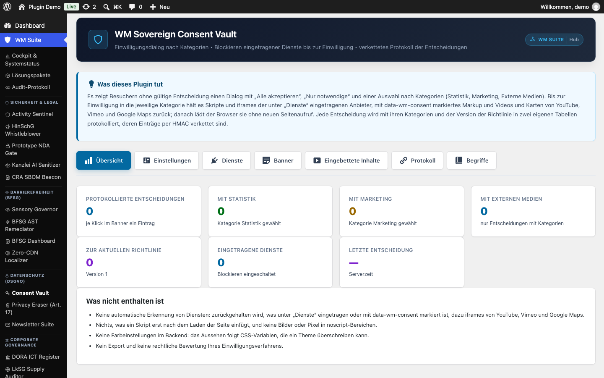
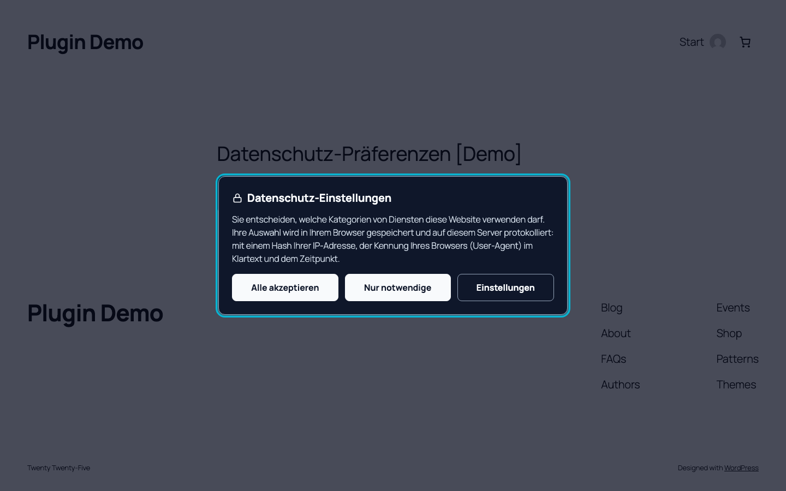
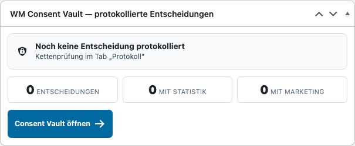

# WM Sovereign Consent Vault (Documentación en Español)

<p align="center">
  <a href="README.md"></a>
  <a href="README.de.md"></a>
  <a href="README.es.md"></a>
</p>

> **Pregunta a los visitantes por categorías, retiene los scripts y los contenidos incrustados de los servicios registrados hasta que los acepten, y registra cada decisión con sus categorías en la base de datos del propio sitio como una entrada encadenada con HMAC**  
> **Página del plugin:** [https://arnoldwender.com/es/plugins-wordpress/wm-sovereign-consent-vault/](https://arnoldwender.com/es/plugins-wordpress/wm-sovereign-consent-vault/)  
> **Desarrollado con un agentic workflow:** creado con agentes de programación de IA. Revísalo y pruébalo como cualquier código de terceros antes de usarlo en producción.  
> **Soporte y responsabilidad:** Cero soporte (Zero Support) — errores reproducibles únicamente en [GitHub Issues](https://github.com/arnoldwender/wm-wp-sovereign-consent-vault/issues) · sin soporte privado · TAL CUAL («AS IS») / sin responsabilidad ([SUPPORT.md](SUPPORT.md))

> Medido frente a la versión `1.2.2` del código: shortcode `[wm_consent_settings]`, WP-CLI `wp consent audit_merkle`, rutas REST `/nonce`, `/record` y `/verify-merkle` bajo `wm-consent/v1`, Block Bindings de WordPress 6.5+ (`wm-consent/status`), etiqueta dinámica de GenerateBlocks 2.x (`{{wm_consent_status}}`), las tablas `wp_wm_consent_records` y `wp_wm_consent_merkle_nodes` (cadena lineal HMAC-SHA256), borrado explícito opcional al desinstalar y 28 catálogos `.po`/`.mo` compilados. El plugin no realiza ninguna valoración jurídica del sitio.

---

## Capturas en vivo

!Banner de WM Sovereign Consent Vault

| Consola | Diálogo modal | Widget del escritorio |
|---|---|---|
|  |  |  |

---

## Qué hace el plugin

1. **Diálogo de consentimiento por categorías.** En `wp_footer`, para cada visitante cuyo navegador no guarda una decisión para la versión actual de la política, un diálogo modal (`role="dialog"`, `aria-modal`, nombrado por su encabezado y descrito por su texto) con «Alle akzeptieren» y «Nur notwendige» con el mismo estilo, y «Einstellungen» con un interruptor por categoría: **necesarias** (siempre activas), **estadística**, **marketing** y **medios externos**, cada una con su descripción y los servicios registrados de esa categoría (proveedor, finalidad, cookies, política de privacidad del proveedor). El script lleva el foco al diálogo, lo mantiene dentro al tabular y lo devuelve al cerrar; el diálogo de la primera visita solo se cierra con una elección, y uno abierto a propósito también con Escape o su botón de cierre. Colores y tamaños salen de custom properties en `assets/css/wm-consent-vault.css` (sin estilos en línea, contraste de texto de al menos 4,5:1, objetivos de al menos 44 px). Enlaza la política de privacidad (la página de Ajustes › Privacidad si no se configura otra URL) y el aviso legal; en esas dos páginas el diálogo no se abre solo. Para reabrirlo: `[wm_consent_settings]`, un enlace a `#wm-consent-settings`, cualquier elemento con `data-wm-consent-open` o `window.wmConsent.open()`.
2. **Bloqueo antes del consentimiento.** En cada página del frontend, `includes/Blocker/OutputBlocker.php` reescribe el HTML con un búfer de salida (abierto tarde en `template_redirect`, para que un plugin de caché guarde la página bloqueada) y con `wp_script_attributes`, `wp_inline_script_attributes` y `script_loader_tag` para los scripts que imprime WordPress. Un `<script>` cuya fuente o código en línea contenga un patrón de un servicio registrado, y un script marcado con `data-wm-consent="marketing"`, pasan a `type="text/plain"` con `data-wm-consent-category`, `data-wm-consent-service`, la fuente en `data-wm-consent-src` y un tipo `module` en `data-wm-consent-type`. Un `<iframe>` de YouTube, Vimeo o Google Maps, y el de un servicio registrado de medios externos, se convierten en el marcador de «clic para cargar»; un iframe de otra categoría conserva su fuente en `data-wm-consent-src`. El servidor escribe siempre la forma bloqueada, sea cual sea la decisión del visitante, de modo que una caché de página completa no puede servir una página desbloqueada al siguiente. Tras una decisión, el script activa lo aceptado en orden de documento —un script externo sin `async` se espera antes de pasar al siguiente— sin recargar. Al retirar una categoría borra las cookies registradas de sus servicios en este sitio y recarga. No se tocan: otros tipos de script (JSON-LD, import maps), lo que lleve `data-wm-consent-ignore`, las propias etiquetas del plugin, los comentarios HTML, `<style>` y `<textarea>`.
3. **Servicios y plantillas.** En **Consent Vault › Dienste** cada servicio lleva nombre, identificador, proveedor, categoría, finalidad, política de privacidad del proveedor, nombres de cookies (`_ga_*` cubre una familia) y patrones de host o de archivo (`googletagmanager.com`, `matomo.js`), que casan como nombres completos de host o de archivo. Hay diez plantillas para Google Analytics / Tag Manager, Meta Pixel, Matomo, Hotjar, Microsoft Clarity, LinkedIn Insight Tag, TikTok Pixel, YouTube, Vimeo y Google Maps; sus hosts y cookies se leyeron el 2026-09-17 de la documentación o el código de cada proveedor (las fuentes están en `ServiceRegistry::presets()`). Una plantilla solo se vuelve servicio cuando una administradora la añade.
4. **Ajustes.** **Consent Vault › Einstellungen**: los textos del banner como sustituciones de los textos por defecto traducibles, las URL de la política de privacidad y del aviso legal, la descripción de cada categoría, la **versión de la política** (subirla vuelve a preguntar a todos y queda registrada con cada decisión), la **duración del consentimiento en días**, un interruptor para el bloqueo y una casilla explícita (`wm_consent_delete_data_on_uninstall`) para borrar registros, tablas y ajustes al desinstalar. Los textos por defecto describen lo que el plugin guarda y no afirman conformidad con nada.
5. **Registro de decisiones.** `/nonce` permite por defecto 120 peticiones por minuto por cliente (hash HMAC de la IP, exento para administradores, filtrable con `wm_consent_rest_rate_limit`); `/record` exige el nonce REST (403), permite 10 peticiones por minuto por cliente (clave: HMAC de la IP, por /64 en IPv6, 429) y declara sus parámetros: `uuid` como cadena de 8 a 64 caracteres `[A-Za-z0-9_-]`, los tres indicadores como booleanos y, opcionalmente, `categories` (las cuatro claves) y `policy_version`; unos indicadores que contradigan las categorías, una categoría desconocida o una versión mal formada responden 400. Un uuid ya guardado responde 409 antes de escribir, una cadena ocupada 503 y una decisión no escrita 500. Se guardan el uuid, un HMAC-SHA256 de la IP (clave `wp_salt( 'auth' )`), los tres valores, las categorías aceptadas, la versión de la política, los primeros 255 caracteres del user agent, una firma sobre esos valores y la hora. Cada decisión añade un nodo a una cadena lineal mientras mantiene el bloqueo `wm_consent_chain`: predecesor, firma y un HMAC que enlaza ambos, con la fila y su nodo en una sola transacción. El predecesor sale de la punta registrada, y la opción `wm_consent_chain_tip` guarda ese enlace, el número de nodos y una firma sobre ambos. `wm-dsgvo-privacy-eraser` añade sus sellos de certificado a la misma cadena como nodos ancla.
6. **Dos formatos de firma.** Las filas escritas antes del 2026-09-17 llevan el formato 1 (uuid, hash de la IP, los tres valores, la hora); las nuevas llevan el formato 2, que además firma las categorías, la versión de la política y el user agent. Cada fila se verifica con el formato con el que se escribió y ninguna se vuelve a firmar; una fila de formato 1 que lleve categorías o versión —columnas que su firma no cubre— cuenta como alterada.
7. **Verificación.** `MerkleTreeEngine::verify_chain_integrity()` recorre cada nodo: predecesor, enlace, la firma recalculada de la decisión que hay detrás, las filas que ningún nodo cubre y la punta registrada con su firma y su conteo. Resultado `INTACT` (con el conteo por formato de firma), `EMPTY_CHAIN` (aún nada registrado) o `TAMPERED` con `PREV_HASH_MISMATCH`, `MERKLE_ROOT_CORRUPTED`, `CONSENT_RECORD_MISSING`, `CONSENT_RECORD_ALTERED`, `UNCHAINED_RECORD`, `TIP_UNSIGNED` / `TIP_SIGNATURE_INVALID` o `CHAIN_TRUNCATED`. Disponible como `GET /wp-json/wm-consent/v1/verify-merkle` (`manage_options`), `wp consent audit_merkle`, un botón del admin y el adaptador del hub. Detecta cambios hechos sin la clave; no demuestra que una decisión venga de un visitante real.
8. **Marcadores de carga con clic.** Cada iframe con origen en `youtube.com`, `youtube-nocookie.com`, `youtu.be`, `vimeo.com` / `player.vimeo.com`, `maps.google.com` o `google.com/maps` —en el contenido a través de `the_content` y, mientras el bloqueo esté activo, en toda la página— se sustituye por una caja que nombra al proveedor y dice que un clic establece la conexión y transmite la IP; el origen, el título y la altura del iframe viajan en atributos de datos. También se detecta un origen sin protocolo (`//www.youtube.com/…`). Un clic carga ese contenido y no se registra; el consentimiento a medios externos carga todos los marcadores de la página sin clic.
9. **Para desarrolladores.** Marcado `<script type="text/plain" data-wm-consent="marketing">…</script>` (con o sin `src`) e `<iframe data-wm-consent="media" data-wm-consent-src="…">`. PHP: `wm_consent_has( 'statistics' )` lee la cookie `wm_consent`, la compara con la versión de la política y la duración, y marca la respuesta como no cacheable. JavaScript: `window.wmConsent.has( 'media' )`, `window.wmConsent.open()`, `window.wmConsent.categories()` y el evento `wm-consent:decision` en `document`. Block Bindings y etiquetas dinámicas: `wm-consent/status` (WP 6.5+) y `{{wm_consent_status}}` (GenerateBlocks 2.x). Filtros: `wm_consent_services`, `wm_consent_script_handles`, `wm_consent_script_category`, `wm_consent_blocking_enabled`, `wm_consent_has`, `wm_consent_has_nocache`, `wm_consent_rest_rate_limit`, `wm_consent_status_label`. Acciones: `wm_consent_ready`, `wm_consent_decision_recorded`.
10. **Administración.** Menú *Consent Vault* (posición 84), página `wm-consent-vault`, interfaz en alemán con siete pestañas: resumen (decisiones registradas, por categoría, de la versión actual, servicios registrados, lo que no incluye), Einstellungen, Dienste, el banner tal como lo ven los visitantes, los proveedores del marcador, la cadena (explicación, botón de verificación, últimos diez nodos) y una lista breve de términos. Un widget del escritorio muestra los conteos sin verificar la cadena. Hojas de la familia de administración de WM Suite.
11. **Spoke de WM Suite Hub.** `includes/Adapters/Consent_Vault_Spoke_Adapter.php` se registra con `wm_register_suite_module`: salud `HEALTHY` para una cadena verificada con al menos un nodo, `NEEDS_CONFIG` mientras no hay nada registrado, `ERROR` cuando la verificación falla; telemetría con el número de decisiones (`null` sin la tabla), las decisiones por categoría, la versión de la política y cuántas decisiones le corresponden, estado y error de la cadena, número de nodos, conteo por formato de firma, origen de la clave, punta, el interruptor de bloqueo y el número de servicios registrados; acción `self_test` (falla con cadena vacía o rota).

### No incluido

Ninguna detección automática de los servicios de un sitio: se retiene lo registrado o marcado con `data-wm-consent`, más los proveedores de incrustaciones integrados. Nada que un script inserte después de cargar la página, ni imágenes o píxeles dentro de `<noscript>`. Ninguna señal a la interfaz de consentimiento de un proveedor (Google Consent Mode y similares). Ningún ajuste de colores en el admin (el aspecto sigue custom properties CSS que un tema puede sobrescribir). Ninguna exportación, informe ni certificado. Ningún árbol de Merkle (la cadena es lineal pese al nombre de la clase). Ninguna evaluación de si el diálogo, el bloqueo o el registro cumplen algún requisito legal.

---

## Inicio rápido

1. Instala y activa el plugin (WordPress 6.4+, PHP 8.2+). La activación crea las dos tablas; una actualización añade las tres columnas del esquema 3.
2. Abre **Consent Vault › Dienste** y añade una plantilla por cada servicio que el sitio use de verdad, o crea el tuyo con sus patrones de host o archivo; completa los datos del proveedor.
3. Revisa **Consent Vault › Einstellungen**: textos, URL de la política de privacidad y del aviso legal, descripciones, duración y versión de la política.
4. Abre el sitio en una ventana privada: aparece el diálogo, «Einstellungen» muestra las categorías con sus servicios, y lo aceptado carga sin recargar. En **Consent Vault › Übersicht** la decisión queda contada.
5. Pon `[wm_consent_settings]` en la página de la política de privacidad, o un enlace a `#wm-consent-settings` en un menú, para que los visitantes puedan cambiar su decisión.
6. Para código propio: `<script type="text/plain" data-wm-consent="statistics">` en el marcado y `wm_consent_has( 'statistics' )` en PHP.
7. Opcional: en **Protokoll** pulsa **Kette jetzt prüfen**, o ejecuta `wp consent audit_merkle`.

Clases, rutas, tablas, opciones, filtros y desviaciones conocidas: **[README.md](README.md)** (referencia) y **[DEVELOPERS.md](DEVELOPERS.md)**.

```bash
php tests/test-suite.php        # categorías, ajustes, servicios, formatos de firma, bloqueo, diálogo, admin, cadena, desinstalación
bash tests/run-mutations.sh     # cada corrección de tests/mutations.php debe poner la suite en rojo al deshacerla
# dentro de un WordPress desechable (vacía las tablas de consentimiento):
wp eval-file wp-content/plugins/wm-sovereign-consent-vault/tests/test-consent-chain.php --allow-root
```

### Problemas conocidos

- Si la redacción, las categorías y el bloqueo de un sitio cumplen algún requisito legal no se evalúa aquí; los textos por defecto son neutrales y no los ha revisado un abogado (auditoría de flota D6).
- El bloqueo solo alcanza lo registrado o marcado: un servicio que nadie ha dado de alta carga como antes, y el marcado que un script inserta después de cargar la página queda fuera de alcance.
- La decisión vive en el navegador del visitante. Cualquiera puede pedir el nonce público y enviar una decisión; el límite es de 10 por minuto por cliente. La cadena demuestra que las filas guardadas no se cambiaron después, no que sean auténticas.
- `wm_consent_has()` hace que una página dependa del visitante, así que marca la respuesta como no cacheable (`DONOTCACHEPAGE` y cabeceras no-cache). El marcado que deba esperar sin ese coste va en `data-wm-consent`.
- Al revocar solo se borran las cookies que un script de este sitio alcanza: este dominio y sus superiores, ruta `/`. Las cookies en el dominio del proveedor permanecen.
- El búfer de salida retiene la página hasta el final: un tema que envía la cabecera antes de tiempo pierde esa ventaja.
- La IP se guarda como hash con clave (seudónimo, no anónimo); el user agent en claro y, desde el formato 2, firmado.
- La verificación hace una consulta por nodo; la salud y la telemetría del hub la ejecutan en cada llamada, lo que crece con el registro.
- Desinstalar conserva por defecto ambas tablas y las opciones del plugin salvo que se active expresamente `wm_consent_delete_data_on_uninstall` en **Consent Vault › Einstellungen**.
- Los marcadores y la reescritura de la página trabajan sobre el HTML como texto; un marcado que no sea HTML válido puede pasar sin cambios.
- Las filas escritas por otra instalación (una base de datos copiada) llevan su clave y aquí se leen como `MERKLE_ROOT_CORRUPTED`; nada las distingue de filas falsificadas.
- Cambiar `AUTH_KEY` hace que toda entrada existente se lea como alterada: las filas no llevan versión de clave.
- La fila y su nodo son una transacción, pero la punta es una opción escrita tras el commit. Un proceso interrumpido en ese hueco deja la punta un nodo por detrás, lo que la verificación informa como `CHAIN_TRUNCATED`: una rotura por interrupción, no por manipulación, y el plugin no puede distinguirlas. No repara nada.
- Una clave que siga siendo la frase de ejemplo de `wp-config-sample.php` se informa (`key_is_sample`); entonces cualquiera puede falsificar la cadena.
- Desinstalar limpia el sitio donde se ejecuta; en una instalación multisitio los demás conservan sus tablas y opciones.
- `languages/` trae 28 catálogos generados desde el código; los textos que desaparecen quedan como entradas obsoletas.

---

## Cumplimiento

- **Lo que el plugin establece:** que un navegador aceptó un conjunto de categorías en un momento dado y bajo una versión concreta de la política, guardado con una firma y un enlace que revelan cambios posteriores hechos sin la clave; y que los scripts y contenidos registrados para una categoría no se cargan antes de aceptarla. No evalúa si el diálogo, el bloqueo o el registro cumplen DSGVO, TDDDG o alguna sentencia, y no vuelve conforme un sitio.
- **Peticiones salientes:** ninguna. El navegador del visitante contacta a los servicios registrados y a los proveedores incrustados solo tras aceptar su categoría o pulsar el marcador.
- **Datos personales:** por decisión, un hash con clave de la IP, el user agent, las categorías, la versión de la política y la hora, en dos tablas de la base de datos del sitio; no se envía nada a otro lugar. En el navegador: las claves de localStorage de la decisión y la cookie `wm_consent`, que vive lo que dure el consentimiento configurado. Desinstalar conserva tablas y opciones salvo activación expresa del borrado.

---

## Licencia

Distribuido bajo licencia **GNU General Public License v2 o posterior** (`GPL-2.0-or-later`).  
Copyright (C) 2026 Arnold Wender. Todos los derechos reservados.  
