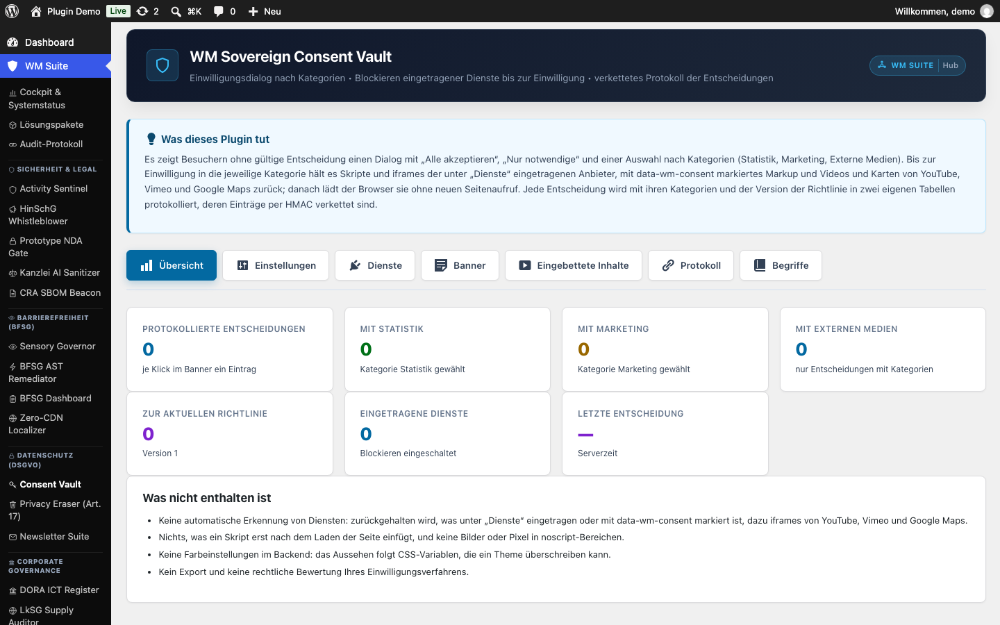

# WM Sovereign Consent Vault (Malti)

  [🇧🇬 Български](README.bg.md) • [🇨🇿 Čeština](README.cs.md) • [🇩🇰 Dansk](README.da.md) • [🇩🇪 Deutsch](../../README.de.md) • [🇬🇷 Ελληνικά](README.el.md) • [🇬🇧 English](../../README.md) • [🇪🇸 Español](../../README.es.md) • [🇪🇪 Eesti](README.et.md) • [🇫🇮 Suomi](README.fi.md) • [🇫🇷 Français](README.fr.md) • [🇮🇪 Gaeilge](README.ga.md) • [🇭🇷 Hrvatski](README.hr.md) [🇭🇺 Magyar](README.hu.md) • [🇮🇹 Italiano](README.it.md) • [🇱🇹 Lietuvių](README.lt.md) • [🇱🇻 Latviešu](README.lv.md) • [🇲🇹 Malti](README.mt.md) • [🇳🇱 Nederlands](README.nl.md) • [🇵🇱 Polski](README.pl.md) • [🇵🇹 Português](README.pt.md) • [🇷🇴 Română](README.ro.md) • [🇸🇰 Slovenčina](README.sk.md) • [🇸🇮 Slovenščina](README.sl.md) • [🇸🇪 Svenska](README.sv.md)

---

  
  
  
  
  

> **Asks visitors per category, holds back the scripts and embeds of the registered services until they accept, and logs every decision with its categories in the site's own database as an HMAC-chained record**  

---

## 📸 Malti Enterprise Showcase

!WM Sovereign Consent Vault Banner

---

## 🟢 LIVELL 1: GWIDA TA' BIDU MALAJR GĦAL DAWK LI QED JIBDEW (NO-CODE)

### X'jagħmel dan il-plugin għall-websajt tiegħek?
Asks visitors per category, holds back the scripts and embeds of the registered services until they accept, and logs every decision with its categories in the site's own database as an HMAC-chained record

### 🚀 Kif tibda f'2 minuti (Pass pass):
1. Install and activate the plugin (WordPress 6.4+, PHP 8.2+). Activation creates the two tables; an update adds the three columns of schema 3.
2. Open **Consent Vault › Dienste** and add a preset for every service the site really uses, or enter your own with its host or file patterns; complete the provider details.
3. Check **Consent Vault › Einstellungen**: texts, the URLs of the privacy policy and the legal notice, the descriptions, the consent duration and the policy version.
4. Visit the site in a private window: the dialog appears, "Einstellungen" shows the categories with their services, and the accepted scripts and embeds load without a reload. Under **Consent Vault › Übersicht** the decision is counted.
5. Put `[wm_consent_settings]` on the privacy policy page, or a link to `#wm-consent-settings` in a menu, so visitors can change their decision.
6. For code of your own: `` (with or without `src`) and `<iframe data-wm-consent="media" data-wm-consent-src="…">`. PHP: `wm_consent_has( 'statistics' )` reads the `wm_consent` cookie, checks it against the policy version and the duration, and marks the response as not cacheable. JavaScript: `window.wmConsent.has( 'media' )`, `window.wmConsent.open()`, `window.wmConsent.categories()` and the event `wm-consent:decision` on `document`. Block Bindings & Dynamic Tags: WordPress 6.5+ source `wm-consent/status` and GenerateBlocks 2.x tag `{{wm_consent_status}}`. Filters: `wm_consent_services`, `wm_consent_script_handles`, `wm_consent_script_category`, `wm_consent_blocking_enabled`, `wm_consent_has`, `wm_consent_has_nocache`, `wm_consent_rest_rate_limit`, `wm_consent_status_label`. Actions: `wm_consent_ready`, `wm_consent_decision_recorded`.
10. **Admin.** Menu *Consent Vault* (position 84), page `wm-consent-vault`, German interface with seven tabs: overview (logged decisions, per category, for the current policy version, registered services, what is not included), Einstellungen, Dienste, the banner as visitors see it, the placeholder hosts, the chain (explanation, verify button, last ten nodes) and a short list of terms. A dashboard widget shows the counts without verifying the chain. Family sheets of the WM Suite admin.
11. **WM Suite Hub spoke.** `includes/Adapters/Consent_Vault_Spoke_Adapter.php` registers through `wm_register_suite_module`: health `HEALTHY` for a verified chain with at least one node, `NEEDS_CONFIG` while nothing was recorded, `ERROR` when verification fails; telemetry with the decision count (`null` without the table), the decisions per category, the policy version and how many decisions were given for it, chain state and error, node count, the count per signature format, key source, tip, the blocking switch and the number of registered services; action `self_test` (fails on an empty or broken chain).

### Not shipped
No detection of the services a site uses: what is held back are the registered services, the markup marked with `data-wm-consent` and the built-in embed providers. Nothing a script inserts after the page has loaded, and no images or pixels inside `<noscript>`. No signals to a vendor's own consent API (Google Consent Mode and its like). No colour settings in the admin (the appearance follows CSS custom properties a theme can override). No export, report or certificate. No Merkle tree (the chain is linear despite the class name). No assessment of whether the dialog, the blocking or the log meets any legal requirement.

---

## 🔴 LIVELL 3: GWIDA GĦALL-IŻVILUPPATURI U ARKITETTI TA' SOFTWARE

Classes, hooks, options, the admin screen and the WM Suite Hub adapter are documented in the English manual: **[DEVELOPERS.md](../../DEVELOPERS.md)**.

---

## ⚖️ Konformità Legali u Regolatorja Ewropea

- **What the plugin establishes:** that a browser accepted a set of categories at a given time, under a given policy version, stored with a signature and a chain link that reveal later changes, insertions and deletions made without the key; and that the scripts and embeds registered for a category are not loaded before that category is accepted. It does not assess whether the dialog, the blocking or the log satisfies DSGVO, TDDDG or any judgment, and it does not make a site compliant.
- **Outbound requests:** none. Registered services and embedded providers are contacted by the visitor's browser only after their category is accepted or the placeholder is clicked.
- **Personal data:** per decision a keyed hash of the IP address, the user agent, the categories, the policy version and the time, in two tables of the site's database; nothing is sent elsewhere. In the visitor's browser: the localStorage keys of the decision and the cookie `wm_consent`, which lives as long as the configured duration. Uninstalling preserves the tables and options unless deletion on uninstall is opted in.

---

## 🔒 Liċenzja u Drittijiet Proprjetarji

Distributed under the **GNU General Public License v2 or later**.  
Copyright (C) 2026 Arnold Wender.  
